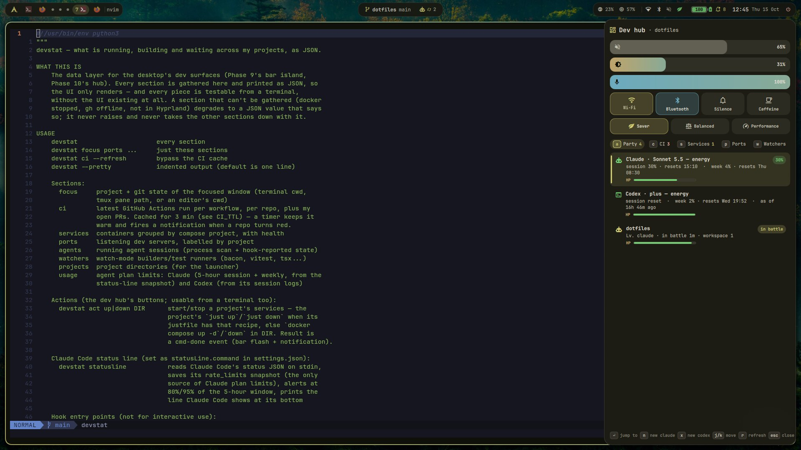
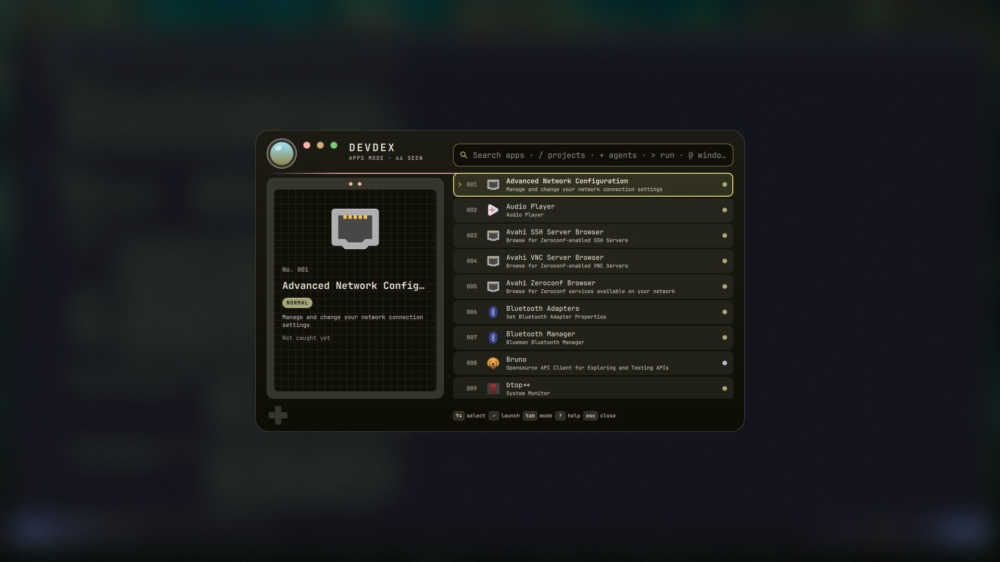
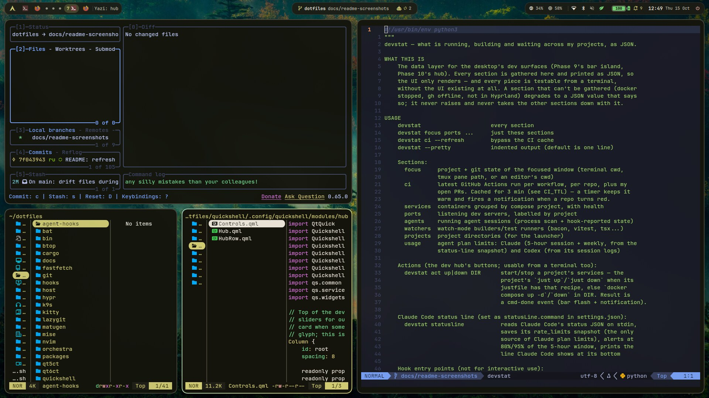
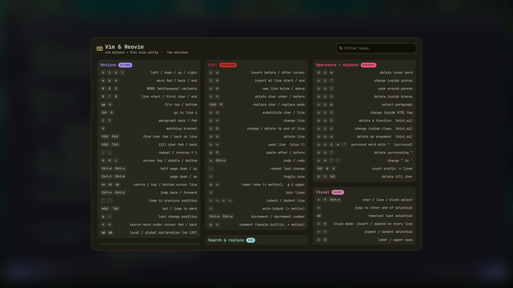
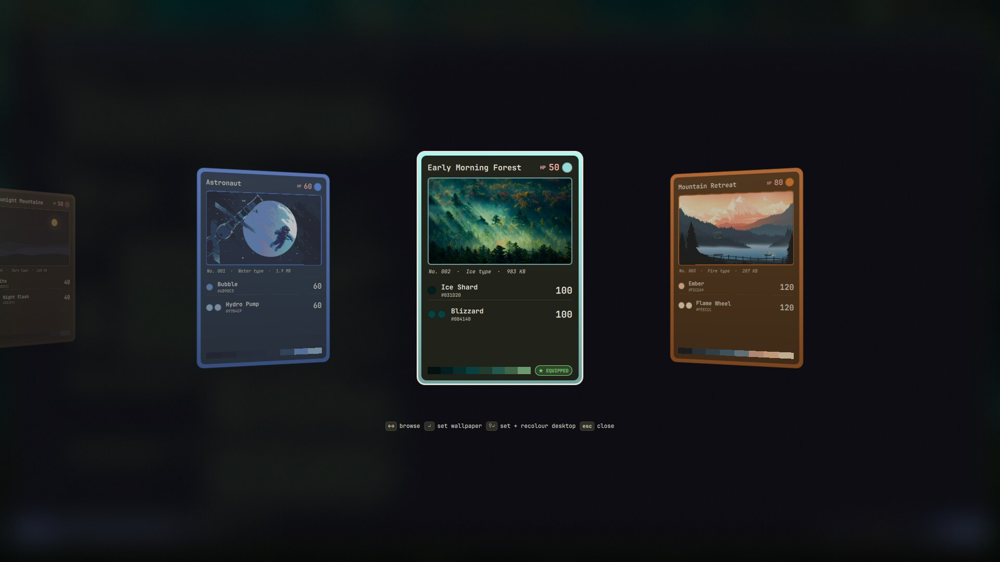
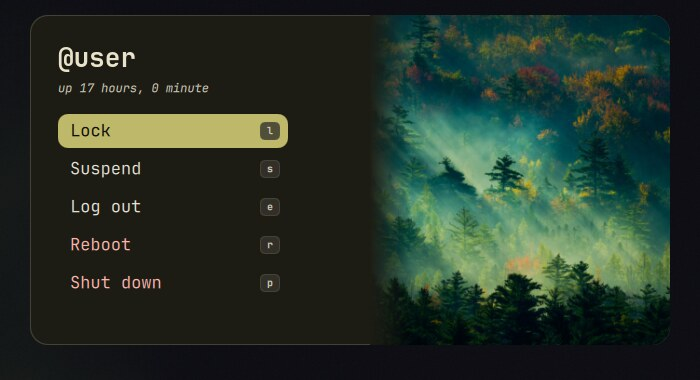

<div align="center">

# dotfiles

**An Arch Linux + Hyprland desktop built around one question:
_what is my code doing right now?_**

Agents, CI, containers, dev servers and PRs are one keypress away, and the
whole setup rebuilds from a single command.



`Hyprland` · `Quickshell` · `Neovim` · `kitty + zsh` · `matugen` · `GNU Stow`

</div>

---

## Why this is useful for developers

Most rices optimise for looks. This one optimises for the loop of writing code,
running it, and finding out whether it worked. The look is a bonus.

| Problem | What this setup does |
|---|---|
| "Did CI go red while I was in the editor?" | A timer polls GitHub Actions every 3 min and notifies **only** on a default-branch red/green change, and only if you're not already looking at that project. |
| "Is my coding agent waiting on me?" | Claude/Codex sessions report state through a small hook plugin. The bar, hub and notifications show *working*, *needs input* and *finished*, and <kbd>Enter</kbd> jumps to the exact window or tmux pane. |
| "What's running on this machine?" | Compose services, listening dev servers and watch-mode builders (`vitest`, `tsx`, `bacon`…) per project, with start/stop/logs buttons. |
| "Which project am I in?" | The bar's centre island follows the **visible kitty tab**: project, branch, dirty state, agents. |
| "Review what the agent changed." | When a long agent turn ends while you're away, project checks run (`just check`, `package.json` scripts, or `cargo clippy + test`) and a **Review** action opens Neovim + diffview, branch vs `main`. |
| "Set up a new machine." | `./bootstrap.sh` is idempotent. Every config is a stow package, everything else is a numbered hook. |
| "Does it still work on a clean box?" | Read-only `scripts/verify-*.sh` checks cover each area, and `verify-portability.sh` fails if anything machine-specific leaks into the repo. |

Anything that isn't for developers (weather, pomodoro, screen time, phone widgets) is
deliberately left out.

---

## A tour

### Dev hub: `$mod + Space`

A keyboard-first drawer. Sections are one letter each:

| Key | Section | What you can do |
|---|---|---|
| `a` | Agents (the "Party") | see Claude/Codex sessions and plan usage; <kbd>Enter</kbd> jumps to the window |
| `c` | CI + PRs | <kbd>Enter</kbd> opens the run, `l` opens the failed log in a terminal |
| `s` | Compose services | <kbd>Enter</kbd> logs, `u`/`d` up/down (uses a project's `just up/down` when present), `z` lazydocker |
| `p` | Listening dev servers | what's bound to which port, labelled by project |
| `w` | Watchers | running test/build watchers |

Plus volume, brightness and mic sliders, Wi-Fi/Bluetooth/Silence/Caffeine
toggles, a power-profile selector and now-playing. Open a section from a
script with `qs ipc call hub openSection <letter>`.

### Launcher: `$mod + D`



A Pokédex-style launcher with frecency ranking ("caught" counts) and modes
you reach by typing a prefix:

| Prefix | Mode |
|---|---|
| *(none)* | apps |
| `/` | projects: opens a tmux session through `work` |
| `>` | run a command (<kbd>Shift+Enter</kbd> runs it in a terminal) |
| `@` | switch to an open window |
| `=` | calculator (`qalc`) |
| `:` | emoji |
| `?` | help |

### Terminal workflow



kitty + zsh + starship, with lazygit, yazi, btop and k9s all following the
active theme. `work` is a tmux sessionizer over `~/projects`; `wt new <branch>`
gives each agent task its own git worktree; `queues` prints BullMQ queue
status over `valkey-cli`; `ssh-connect` (<kbd>$mod+S</kbd>) picks from your
`~/.ssh/config` hosts. A zsh hook notifies when a command that ran 30 s or
more finishes while you're elsewhere.

### Neovim

Neovim 0.11+ on lazy.nvim and the **native** `vim.lsp.config` API: vtsls,
eslint, lua_ls, tailwindcss, jsonls, yamlls, dockerls, compose and taplo via
Mason; rust-analyzer via rustaceanvim. Treesitter on the `main` branch,
blink.cmp, fzf-lua, neotest, trouble, and an agent-review set: gitsigns hunks,
diffview, a lazygit float, and autoread so agent edits appear live.

`$mod + /` opens a cheatsheet generated live from `hyprctl binds`. <kbd>Tab</kbd>
flips to a hand-curated Vim and Neovim tab.



### Theming

One command re-themes the whole desktop: kitty, Quickshell, Hyprland, rofi,
GTK/Qt, cursor, yazi, k9s, Obsidian, hyprlock and wlogout.

```sh
theme tokyonight   # default
theme f1           # pixel-art breakaway (partial)
theme wallpaper    # generated from the current wallpaper with matugen
theme              # interactive picker
```

`theme wallpaper` extracts a Material You palette from whatever wallpaper is
set and regenerates every app's colours. It never runs automatically. The
wallpaper picker (`$mod + W`) is a deck of Pokémon-style cards; <kbd>Enter</kbd>
sets the wallpaper and <kbd>Shift+Enter</kbd> also recolours the desktop.



A theme can be partial: one that defines a single app's file leaves everything
else as it was.

### Power menu and lock



`$mod + P` opens the power menu. Reboot and shut down need a second press.
The lock screen is hyprlock with a trainer-card layout, and fingerprint login
self-enables wherever a reader exists.

---

## Quick start

Arch Linux only. **Read `bootstrap.sh` and `hooks/` first**: they install
packages, enable services and change your login shell.

```sh
git clone https://github.com/rustiqz/dotfiles.git ~/dotfiles
cd ~/dotfiles
./bootstrap.sh
```

HTTPS rather than SSH, because a fresh machine has no key registered yet.
Nothing in the repo bakes in a username or home path, so any account works.

`bootstrap.sh` is safe to re-run any time. It:

1. runs `pacman -Syu` (never a partial upgrade) and installs `git`, `stow`, `base-devel`
2. builds `paru` from source if it's missing
3. installs everything in `packages/*.txt` (official repos and AUR)
4. symlinks every app config into `$HOME` with GNU Stow, moving conflicting files to `*.pre-dotfiles.bak`
5. runs `hooks/` in filename order: services, shell, git identity seed, Docker, Rust toolchain, theme default and so on
6. warns about any command a Hyprland config calls that no manifest installs

Per-machine and private values go in untracked `*.local` files (git identity,
`~/.ssh/config.local`, a shell tweak file). The relevant hook seeds a
commented placeholder so they're easy to find.

Check that everything works. These scripts are read-only and print
pass/fail/warn per check:

```sh
./scripts/verify-phase5.sh        # Hyprland session, one script per area (ls scripts/)
./scripts/verify-popovers.sh      # bar popovers
./scripts/verify-portability.sh   # nothing machine-specific is tracked
```

---

## Keybinds

`$mod` is Super. The live list is always `$mod + /`.

| Bind | Action | Bind | Action |
|---|---|---|---|
| `Return` | Terminal | `Space` / `` ` `` | Dev hub |
| `D` | Launcher | `/` | Cheatsheet (<kbd>Tab</kbd>: Vim) |
| `B` | Firefox | `E` | Files (nautilus) |
| `Y` | yazi | `C` | k9s |
| `S` | SSH picker | `M` | Spotify |
| `N` | Notification centre | `.` | Emoji picker |
| `W` | Wallpaper picker | `Shift+T` | Theme picker |
| `P` | Power menu | `Escape` | Lock |
| `Q` | Close window | `Shift+E` | Exit session |
| `h/j/k/l` | Focus | `Shift+h/j/k/l` | Move window |
| `Ctrl+h/j/k/l` | Resize | `Tab` / `Shift+Tab` | Cycle windows |
| `1-9`, `0` | Workspace | `Shift+1-9`, `Shift+0` | Move window to workspace |
| `Ctrl+V` | Clipboard history | `Ctrl+Shift+V` | Wipe history |

Screenshots use `Print`: region, `$mod+Print` window, `$mod+Shift+Print` full
screen. Add `Ctrl` (or `Alt` for windows) to edit afterwards.

---

## How it's built

```
bootstrap.sh          idempotent provisioner
packages/             pacman.txt, aur.txt (shared) and host-<hostname>.txt
hooks/                numbered post-install scripts (services, shell, docker, rust, theme…)
host/<hostname>/      per-machine fragments, only when something truly differs
bin/                  devstat, theme, work, wt, review, checks, queues, ssh-connect…
quickshell/           the bar, hub, launcher, popovers, cheatsheet and notifications (QML)
themes/<name>/        per-app colour files that bin/theme repoints
matugen/              templates for the generated wallpaper theme
agent-hooks/          the plugin that reports agent state to devstat
scripts/              verify-*.sh assertions, preview-lock.sh, dump-repo.sh
<app>/                stow packages: kitty/, nvim/, hypr/, zsh/, tmux/…
```

Every other top-level directory is a stow package whose inner tree mirrors
`$HOME`. Adding an app's config needs no change to `bootstrap.sh`.

**`devstat` is the data layer.** `bin/bin/devstat` prints what is running,
building and waiting as JSON, using only the Python standard library. The bar,
hub and popovers just render it, so everything is testable from a terminal.
Each section degrades to a value that says why (Docker stopped, `gh` offline)
instead of throwing.

**Conventions**

- Every config change lands in the repo. If it can't be a file, it's a hook.
- Everything is idempotent.
- Machine differences are a `host-<hostname>.txt` entry or a `host/<hostname>/` fragment, never a hostname `if` in a shared file.
- No secrets. SSH keys, `.env` and tokens are gitignored; anything private lives in a sibling `*.local` file.
- Font: JetBrainsMono Nerd Font.

---

## Hardware

Developed on an Intel laptop (Comet Lake-U, integrated graphics, systemd-boot
with a UKI) and replayed on a second machine. Expect to adjust
`packages/host-*.txt`, display setup and fingerprint support for different
hardware.

## Credits and licence

MIT, see [`LICENSE`](LICENSE). That covers the configs and scripts only. The
images in `wallpapers/` are third-party and keep their own terms. Replace them
if you redistribute. TokyoNight, matugen, Quickshell, Hyprland, pokeget and the
other tools and plugins belong to their authors. The Pokémon theming is an
affectionate homage, not an affiliated project.
